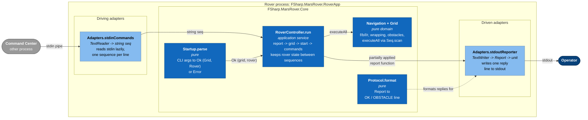
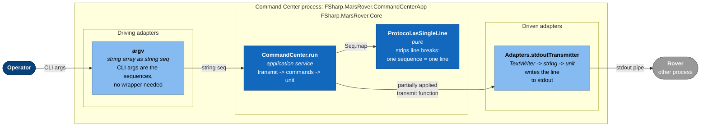
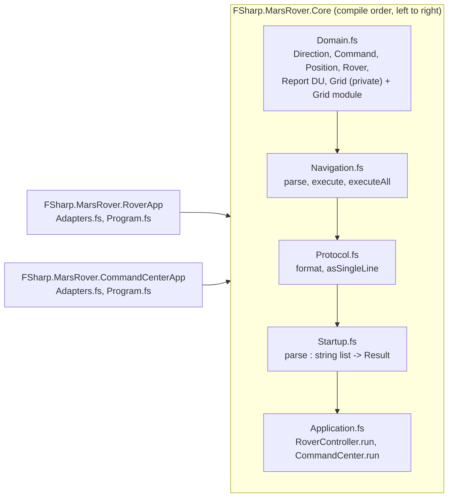

# Components: Mars Rover, F# implementation (hexagonal)

The F# version has the same hexagons, ports and wire protocol as the [C# version](c4-components.md), so the two can be swapped at the [container](c4-containers.md) level. The main difference is that there are **no classes or interfaces**:

- **Ports are function types.** A driving port is a `seq<string>` of command sequences, read lazily. A driven port is a function such as `Report -> unit` or `string -> unit`.
- **Application services are curried functions.** Adapters come first, so each composition root (`Program.fs`) wires in its I/O by partial application. Tests pass `ResizeArray.Add` instead of the stdout adapters.
- **Validation returns `Result`.** `Grid.create` and `Startup.parse` return `Result<_, string>`, and the composition root matches on `Ok`/`Error`. Nothing throws.
- **`Report` is a discriminated union.** `Completed of Rover | Blocked of Rover * obstacle: Position` replaces the record with a nullable obstacle.

Dependencies always point inwards, from adapters to `FSharp.MarsRover.Core`. The diagrams use the same layered flowchart style and colours as the [C# components](c4-components.md).

## Rover

## Command Center

## Core module map

F# compiles files in order, so each file can only use the files before it. The arrows show that ordering, not necessarily a direct call.

In tests, the adapters are replaced by `ResizeArray.Add` and in-memory lists (`ApplicationTests.fs`). Only `EndToEndTests.fs` uses the real console adapters and processes.
