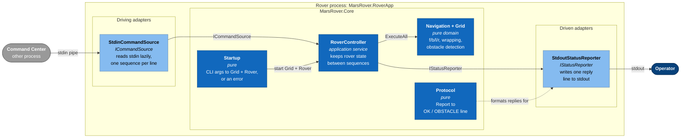
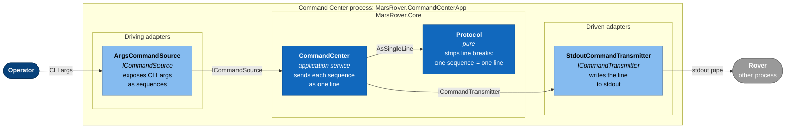

# Components: Mars Rover, C# implementation (hexagonal)

The F# implementation is described in [c4-components-fsharp.md](c4-components-fsharp.md).

Each process is a hexagon. Adapters at the edges do the I/O, and each process's composition root (`Program.cs`) wires them in. Ports and application services come from `MarsRover.Core`, together with the pure domain (`Navigation`, `Grid`), `Protocol` and `Startup`. Dependencies always point inwards, from adapters to core.

The diagrams are Mermaid flowcharts in C4 colours rather than `C4Component` diagrams. Mermaid's C4 renderer has no automatic layout, whereas flowcharts lay out each hexagon left to right: driving adapters, core, driven adapters. Light blue boxes are adapters, dark blue boxes are core, and grey boxes are the other process. Dotted arrows point to the adapter that uses a pure helper.

## Rover

## Command Center

In tests, the adapters are replaced by in-memory fakes (`ApplicationTests`). Only `EndToEndTests` uses the real console adapters and processes.
