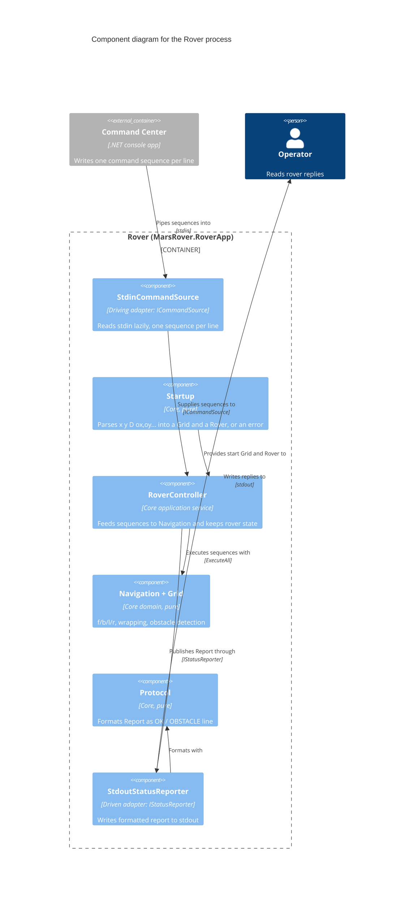
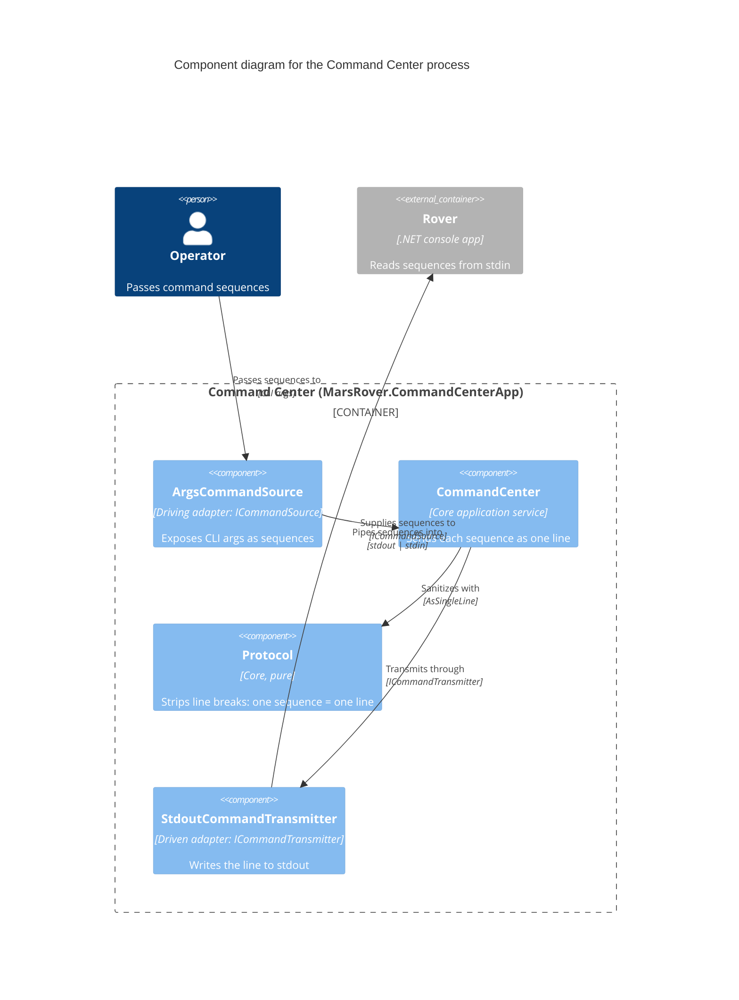

# Components: Mars Rover (hexagonal)

Each process is a hexagon. Adapters at the edges do the I/O, and each process's composition root (`Program.cs`) wires them in. Ports and application services come from `MarsRover.Core`, together with the pure domain (`Navigation`, `Grid`), `Protocol` and `Startup`. Dependencies always point inwards, from adapters to core.

## Rover

## Command Center

In tests, the adapters are replaced by in-memory fakes (`ApplicationTests`). Only `EndToEndTests` uses the real console adapters and processes.
