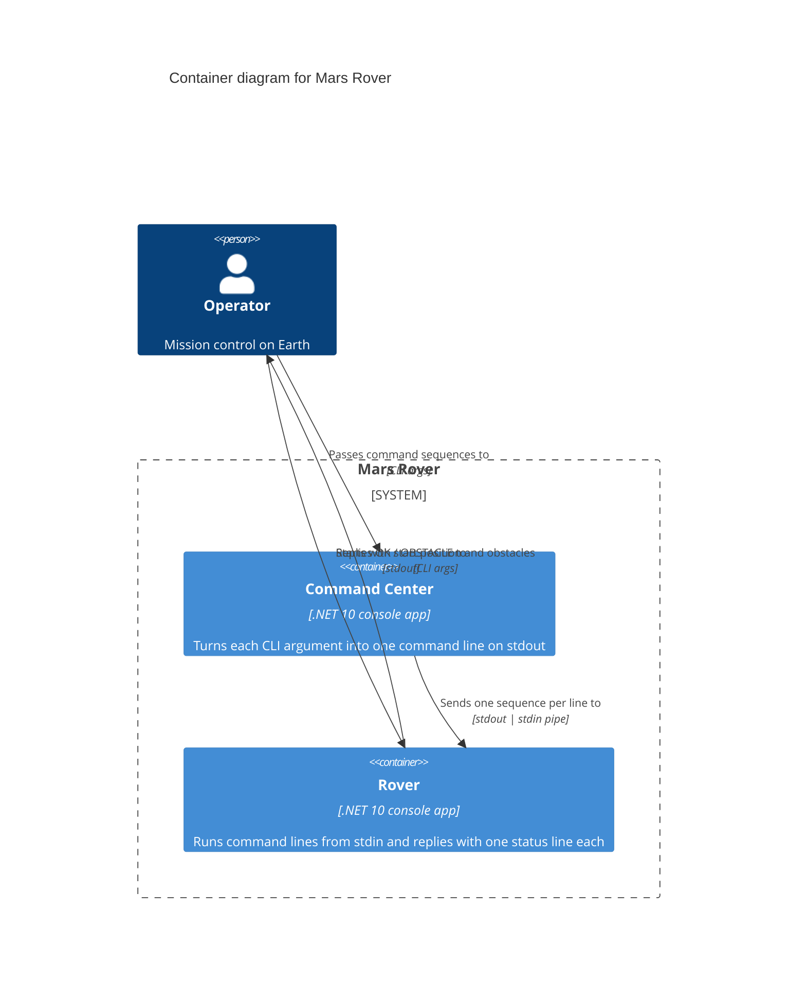

# Containers: Mars Rover

There are two independent executables, connected by a one-way OS pipe (`CommandCenterApp | RoverApp`). Both use the shared `MarsRover.Core` library. Core is a library, not a deployable unit, so it appears in [c4-components.md](c4-components.md) and not here.

The wire format is described in the [README](../../README.md#protocol).

## Two interchangeable implementations

Each container exists twice: once in C# (`MarsRover.*`, built on `MarsRover.Core`) and once in F# (`FSharp.MarsRover.*`, built on `FSharp.MarsRover.Core`). Both speak the same protocol, so you can mix them on either side of the pipe, for example a C# command center piped into an F# rover. The components inside each container are documented separately: [C#](c4-components.md) and [F#](c4-components-fsharp.md).
