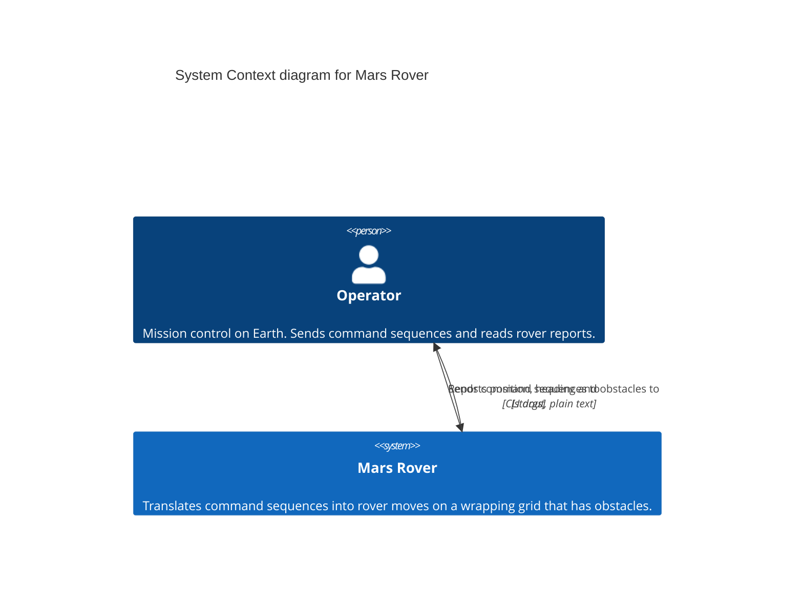

# System Context: Mars Rover

The operator steers a rover on a 100×100 wrapping grid. The whole system runs as local processes, so there are no external systems.

See [c4-containers.md](c4-containers.md) for the processes inside the system. This view is the same for the C# and F# implementations.
